<!-- Repo name must be exactly: Dhruvtemkar29/Dhruvtemkar29 (public) -->

<div align="center">



<br/>

<a href="https://git.io/typing-svg">
  
</a>

<br/>


<br/><br/>

[](https://www.linkedin.com/in/dhruvtemkar)
[](https://github.com/Dhruvtemkar29)
[](mailto:your.email@example.com)

</div>

<br/>

<div align="center">

</div>

<br/>


## ⚡ The Dev Card

<div align="center">

| 🧬 **Identity** | 🎯 **Mission** | 🔥 **Superpower** |
|:---:|:---:|:---:|
| Dhruv Temkar | Build products people love | Idea → shipped, fast |
| 📍 Mumbai ⇄ Bangalore | 🧠 AI · Data · Full-Stack | 🏆 Hackathon mindset |

</div>


## 🛠️ Tech Arsenal

<div align="center">


<br/><br/>


</div>


## 🚀 Featured Projects

<div align="center">

<a href="https://github.com/Dhruvtemkar29/BrainVault-AI">
  
</a>
<a href="https://github.com/Dhruvtemkar29/Career-Navigator-EDA">
  
</a>
<a href="https://github.com/Dhruvtemkar29/desi-vibes-frontend">
  
</a>
<a href="https://github.com/Dhruvtemkar29/desi-vibes-backend">
  
</a>
<a href="https://github.com/Dhruvtemkar29/Hackathon_Christ">
  
</a>

</div>

<details>
<summary><b>🔍 Click to peek inside my project universe</b></summary>
<br/>

| Project | What it is | Stack |
|---|---|---|
| 🧠 **BrainVault-AI** | An AI-powered second brain for knowledge | `Python` |
| 🧭 **Career-Navigator-EDA** | Data exploration that guides career decisions | `Jupyter` |
| 🎨 **Desi Vibes** | Full-stack web app, frontend + backend | `HTML` `JS` |
| 🏆 **Hackathon_Christ** | Hackathon build, made under pressure | `JavaScript` |

</details>


## 📊 Stats That Speak

<div align="center">


</div>


## 🏙️ My Contribution City (3D)

<div align="center">

</div>

## 🐍 The Snake Is Hungry

<div align="center">
<picture>
  <source media="(prefers-color-scheme: dark)" srcset="https://raw.githubusercontent.com/Dhruvtemkar29/Dhruvtemkar29/output/github-snake-dark.svg"/>
  <source media="(prefers-color-scheme: light)" srcset="https://raw.githubusercontent.com/Dhruvtemkar29/Dhruvtemkar29/output/github-snake.svg"/>
  
</picture>
</div>


## 🏅 Achievements Unlocked

<div align="center">


&nbsp;&nbsp;

&nbsp;&nbsp;


<br/>


</div>


## 🎯 Mission Log

```diff
+ [ACTIVE]    Building AI-powered products & full-stack apps
+ [LEARNING]  AI/ML, data storytelling, system design
+ [HUNTING]   The next hackathon trophy 🏆
+ [OPEN]      Collaborations · internships · wild ideas
- [DEPRECATED] Bugs, procrastination, boring UIs
```

<div align="center">


<br/><br/>

### 💬 Got an idea? Let's build it.

[](https://www.linkedin.com/in/dhruvtemkar)

</div>


